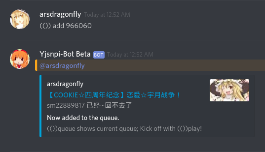

# YJSNPI Bot



This bot has absolutely no Inmu elements. (legit)

[Click here](https://discordbots.org/bot/479293634831843328) to add this bot to your server!

Join the [Magictea Official Discord](https://discord.gg/8RVjgt4) or [author's Discord](https://discord.gg/7sWkRg2) to try it out or test latest features!

Also, check out the [Contribution Guidelines](./CONTRIBUTING.md) if you want you make Yjsnpi-bot become better!

## How to set up

Copy `config.example.ts` to `config.ts` and fill in a token obtained here:
<https://discordapp.com/developers/applications/me>

Then, install FFMpeg:
```bash
$ apt install ffmpeg
```

Then, install Go 1.24 or newer and Lux for Bilibili/YouTube access:

```bash
$ go install github.com/iawia002/lux@master
```

Lux is the maintained successor to Annie. Tagged Lux releases can lag behind
Bilibili changes, so this installs the current master branch. Set `anniePath` in
`config.ts` to the resulting Lux binary (usually `~/go/bin/lux`). The config key
keeps its old name for compatibility.

Next, install Node.js 22.12 or newer. With NVM, run:

```bash
$ nvm install
$ nvm use
```

Copy `config.example.ts` to `config.ts` and fill out the configuration.

Finally, run

```bash
$ npm ci --omit=optional
$ npm run start
```

and you're ready to go.
